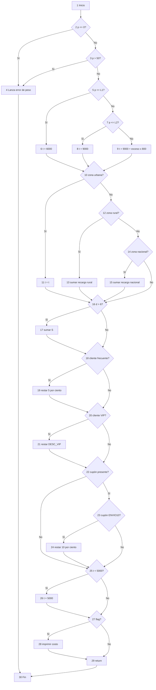
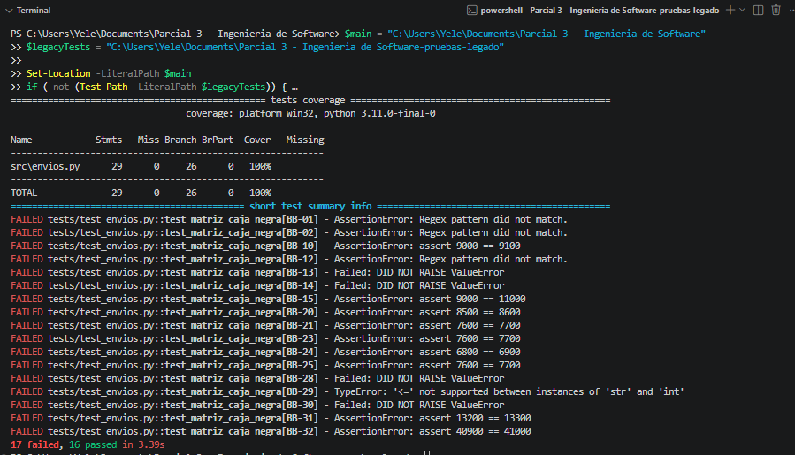
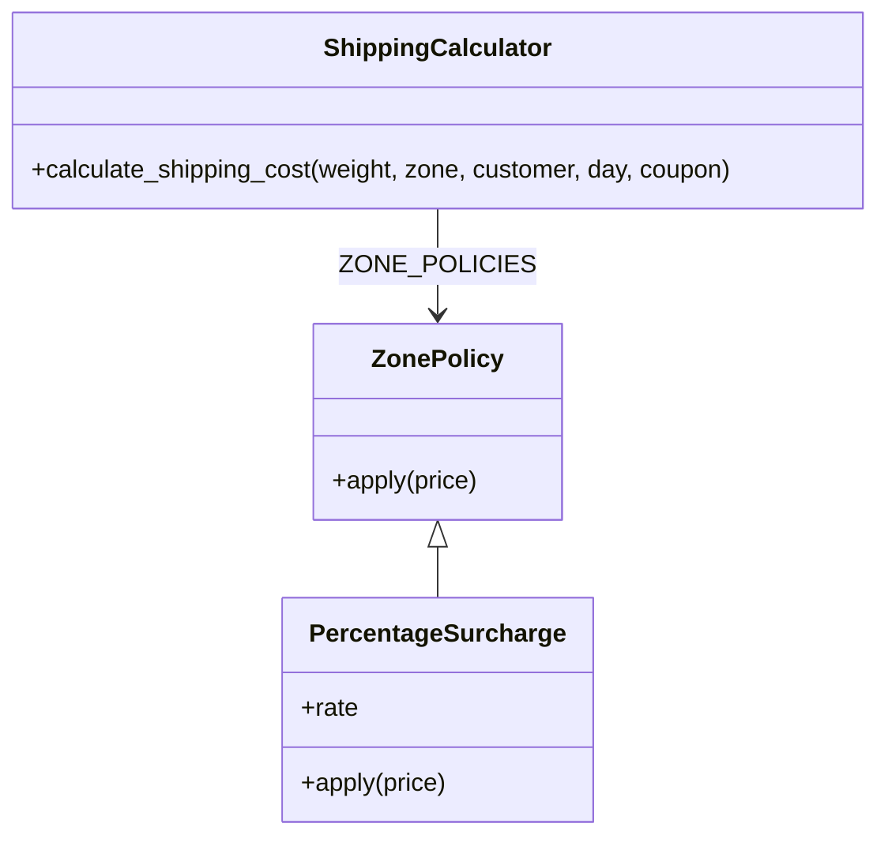
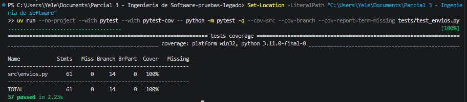
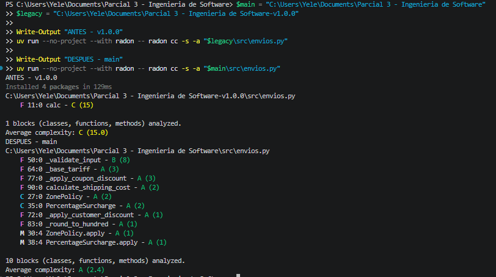
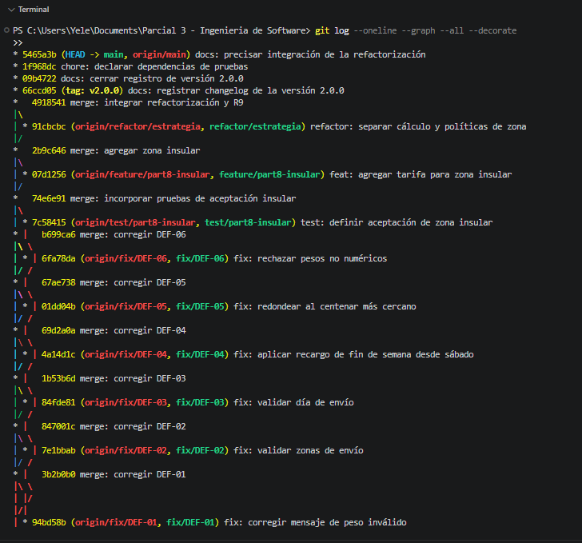
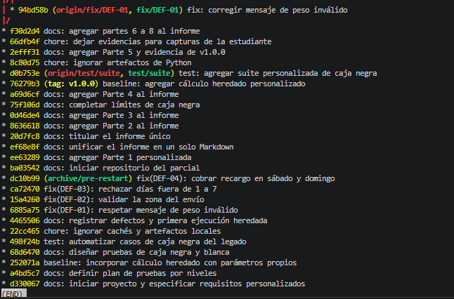
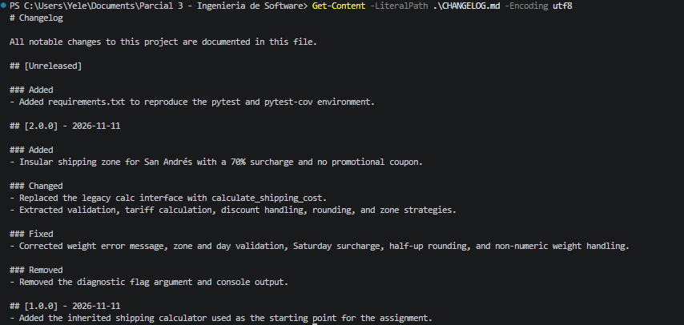
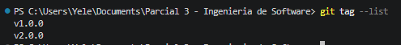
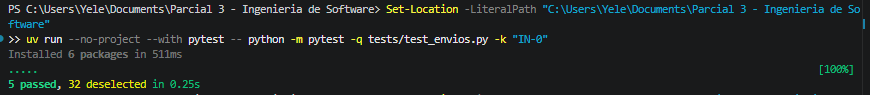

# Informe del Parcial 3 - Ingeniería de Software

## Parte 1. Requisitos y criterios de aceptación

**Estudiante:** Yeleinys Gomez  
**Código estudiantil:** 0182410068  
**Asignatura:** Ingeniería de Software I (273365)  
**Proyecto:** Cotizador de envíos EnvíaYa

## 1.1 Parámetros personalizados

Los seis últimos dígitos de `0182410068` son `410068`; en orden: **A=4, B=1, C=0, D=0, E=6, F=8**.

| A | B | C | D | E | F | PMAX | L1 | L2 | RR | RN | V | S | CAMBIO |
|---:|---:|---:|---:|---:|---:|---:|---:|---:|---:|---:|---:|---:|---:|
| 4 | 1 | 0 | 0 | 6 | 8 | 50 kg | 3 kg | 10 kg | 20 % | 50 % | 15 % | $2.000 | 0 |

**Cálculo de los parámetros:** PMAX = 30 + 5 × 4 = 50; L1 = 2 + (1 mod 3) = 3; L2 = 10 + 0 = 10; RR = 10 + 5 × (6 mod 4) = 20 %; RN = 40 + 5 × (8 mod 3) = 50 %; V = 10 + 5 × (4 mod 3) = 15 %; S = 2.000 + 500 × (0 mod 4) = $2.000; CAMBIO = (4 + 8) mod 3 = 0.

**Reglas de paridad:** D=0 es par, así que el tramo 1 incluye `peso = 3 kg`; E=6 es par, así que el recargo de fin de semana se suma antes de los descuentos; B=1 es impar, así que se aplican los descuentos de cliente y cupón de manera secuencial, primero cliente y luego cupón; F=8 es par, así que un cupón desconocido se ignora.

La solicitud asignada por CAMBIO=0 fue añadir la zona insular con 70 % de recargo y sin cupones. Se implementó y evaluó como evolución en la Parte 8.

## 1.2 Especificación del cálculo (R1–R8)

| ID | Requisito personalizado |
|---|---|
| **R1 — Peso** | El peso debe ser numérico y cumplir `0 < peso ≤ 50 kg`. Si no, se lanza `ValueError("peso inválido")`. |
| **R2 — Dominio** | La zona debe ser `urbana`, `rural` o `nacional`; el día debe ser un entero entre 1 y 7, donde 6 es sábado y 7 es domingo. Si la zona o el día no son válidos, se lanza un error. |
| **R3 — Tarifa base** | Si `0 < peso ≤ 3 kg`, la tarifa es $6.000. Si `3 < peso ≤ 10 kg`, es $9.000. Si `peso > 10 kg`, es `$9.000 + $800 × (peso − 10)`, proporcional para pesos decimales. |
| **R4 — Zona** | Urbana: sin recargo. Rural: sumar 20 % de la tarifa base. Nacional: sumar 50 % de la tarifa base. |
| **R5 — Fin de semana** | Para sábado o domingo, sumar $2.000 después del recargo de zona y antes de los descuentos, porque E=6 es par. En días 1–5 no se suma. |
| **R6 — Descuentos** | Cliente normal: 0 %. Frecuente: 5 %. VIP: 15 %. Cupón `ENVIO10`: 10 %. Si coinciden descuento de cliente y cupón, se aplican ambos de forma secuencial: primero cliente y luego cupón, porque B=1 es impar. |
| **R7 — Cupón desconocido** | Un cupón distinto de `ENVIO10` se ignora, porque F=8 es par. |
| **R8 — Piso y redondeo** | El costo final no puede ser menor que $5.000. Después se redondea al múltiplo de $100 más cercano; los empates de $50 se redondean hacia arriba. |

## 1.3 Historias de usuario y criterios de aceptación

### HU-01 — Validar la solicitud y calcular la tarifa base

**Como** auxiliar de EnvíaYa, **quiero** validar peso, zona y día, y obtener la tarifa base según el tramo, **para** evitar cotizar con entradas inválidas o con una tarifa incorrecta.

| Dado | Cuando | Entonces |
|---|---|---|
| Una solicitud con peso numérico mayor que 0 y menor o igual a 50 kg, zona válida y día entero entre 1 y 7. | El auxiliar solicita el cálculo. | El sistema acepta la solicitud y continúa con las demás reglas del costo. |
| Un peso igual a 0, menor que 0 o mayor que 50 kg. | El auxiliar solicita el cálculo. | El sistema lanza `ValueError("peso inválido")`. |
| Una zona diferente de urbana, rural o nacional, o un día que no sea entero entre 1 y 7. | El auxiliar solicita el cálculo. | El sistema rechaza la solicitud con un error de validación. |
| Un envío urbano de 3 kg y otro de 10,5 kg, ambos en día hábil y sin descuentos. | El auxiliar solicita la tarifa base de cada uno. | El envío de 3 kg queda en el primer tramo y vale $6.000; el de 10,5 kg queda en el tercero y su base es $9.400. |

### HU-02 — Aplicar los recargos de zona y fin de semana

**Como** asesor de envíos, **quiero** aplicar el recargo del destino y el de fin de semana en el orden correcto, **para** informar el costo correspondiente a la ruta y al día del envío.

| Dado | Cuando | Entonces |
|---|---|---|
| Un envío urbano, rural o nacional con la misma tarifa base. | El asesor calcula el recargo territorial. | Urbana no aumenta; rural aumenta 20 %; nacional aumenta 50 %. |
| Un envío de $9.000 a zona urbana, sin descuentos, programado para el sábado. | El asesor calcula el total. | Se suman $2.000 antes de descuentos y el subtotal es $11.000. |
| Un envío programado de lunes a viernes (días 1–5). | El asesor calcula el total. | No se agrega el recargo de $2.000. |

### HU-03 — Aplicar descuentos y obtener un total consistente

**Como** cliente de EnvíaYa, **quiero** que se apliquen mis descuentos, el cupón y el redondeo según las reglas personalizadas, **para** conocer el importe final correcto.

| Dado | Cuando | Entonces |
|---|---|---|
| Un cliente frecuente o VIP con cupón `ENVIO10`. | El sistema calcula el total. | Aplica primero 5 % o 15 % al cliente y después 10 % al cupón. |
| Un cliente con un cupón desconocido. | El sistema calcula el total. | Ignora el cupón y conserva el descuento que corresponda al cliente. |
| Un envío cuyo total con descuentos sea menor que $5.000. | El sistema finaliza el cálculo. | Eleva el costo a $5.000 y luego lo redondea al múltiplo de $100 más cercano, con empate hacia arriba. |

## 1.4 Matriz inicial de trazabilidad

Los IDs de casos se incorporarán al diseñar la caja negra en la Parte 3.

| Requisito | Historia | Casos de prueba |
|---|---|---|
| R1 — Peso | HU-01 | Pendiente de Parte 3 |
| R2 — Dominio | HU-01 | Pendiente de Parte 3 |
| R3 — Tarifa base | HU-01 | Pendiente de Parte 3 |
| R4 — Zona | HU-02 | Pendiente de Parte 3 |
| R5 — Fin de semana | HU-02, HU-03 | Pendiente de Parte 3 |
| R6 — Descuentos | HU-03 | Pendiente de Parte 3 |
| R7 — Cupón desconocido | HU-03 | Pendiente de Parte 3 |
| R8 — Piso y redondeo | HU-03 | Pendiente de Parte 3 |


## Parte 2. Plan de pruebas

### 2.1 Alcance

El plan cubre el cálculo de costos de EnvíaYa definido en R1–R8: validación de peso, zona y día; tramos de tarifa; recargos rural y nacional; recargo de sábado y domingo; descuentos de cliente y cupón; tratamiento de cupón desconocido; piso de $5.000 y redondeo a $100. La solicitud asignada de zona insular (R9) se incorporó al plan de regresión y se evaluó en la Parte 8.

Se probará el módulo de cálculo desde su función pública, primero con el código heredado y después de corregir/refactorizarlo. No se incluyen interfaz gráfica, persistencia, pagos, integraciones con transportadoras ni rendimiento de un sistema de producción.

### 2.2 Niveles de prueba

| Nivel | Aplicación al caso EnvíaYa |
|---|---|
| **Unidad** | Verificar cada decisión del cálculo: validación de peso, elección de tramo, recargo por zona, calendario, descuentos, piso y redondeo. Cada prueba usa entradas controladas y un resultado esperado calculado de forma independiente. |
| **Integración** | Verificar el orden al combinar las reglas: tarifa base → zona → fin de semana → cliente → cupón → mínimo → redondeo. Para R9 se comprobará que la estrategia insular aplique 70 % y rechace todo cupón. |
| **Sistema** | Ejecutar la función completa con solicitudes válidas e inválidas y comprobar el precio final o la excepción observada desde la interfaz pública. Repetir sobre la línea base y la versión corregida. |
| **Aceptación** | Recorrer los criterios Dado/Cuando/Entonces de HU-01 a HU-03, vincular cada resultado con su caso y verificar que los valores coincidan con esta especificación personalizada. En la Parte 8 se añaden criterios de aceptación para R9. |

### 2.3 Estrategia, ambiente y roles

**Estrategia.** Derivar casos de particiones de equivalencia, valores límite y tabla de decisión; diseñar caminos independientes para caja blanca; calcular a mano al menos cinco resultados; escribir primero las pruebas de la solicitud de cambio; ejecutar la regresión después de cada corrección. Medir cobertura de sentencias y ramas y conservar la salida real. Una cobertura alta no se considerará prueba suficiente de corrección.

**Ambiente.** Windows y Python 3.11.0-final-0, según la salida de pytest-cov adjunta. El entorno de pruebas registra pytest 9.2.0 y pytest-cov 7.1.0, declarados en `requirements.txt` y ejecutados con uv. La ejecución heredada corresponde a la etiqueta `v1.0.0`; la regresión final se documenta en la evidencia de la versión `v2.0.0`.

**Roles.** La estudiante actúa como analista de requisitos, diseñadora y ejecutora de pruebas, y responsable del mantenimiento del código. El docente evalúa el informe y dirige la sustentación dinámica indicada en el parcial.

### 2.4 Riesgos y mitigaciones

| Riesgo | Efecto | Mitigación |
|---|---|---|
| Usar parámetros o reglas de otro estudiante como propios. | Resultados esperados, CONFIG e informe no corresponderían al código estudiantil. | Recalcular las fórmulas con `410068`, verificar las paridades y usar ejemplos y casos propios. |
| Interpretar mal el orden de recargos y descuentos. | Precio incorrecto aunque los porcentajes sean correctos. | Escribir el orden en R5–R6, incluir combinaciones en la tabla de decisión y mostrar los subtotales en cálculos manuales. |
| Omitir límites o empates de redondeo. | Defectos en transiciones de tramo o en valores monetarios cercanos a la centena. | Probar valores inmediatamente debajo, en y encima de 0, L1, L2 y PMAX; probar un empate de $50. |
| Registrar como defecto una diferencia causada por un oráculo incorrecto. | Correcciones innecesarias o falsas fallas. | Calcular los esperados a mano desde R1–R8 y revisar cada operación antes de ejecutar la prueba. |
| Perder evidencia o no poder reproducir la ejecución. | Métricas y reporte no verificables. | Guardar salida de pytest, cobertura y capturas en `evidencias/`; anotar comando, versión y commit. |
| Introducir regresiones durante la refactorización o R9. | Una corrección rompe reglas que ya funcionaban. | Mantener la misma matriz de casos, ejecutarla tras cada cambio y añadir primero los casos de R9. |
| Concentrar el historial en un único commit al final. | El proceso de avance solicitado por el docente no sería visible. | Registrar cada archivo o avance real en un commit separado y publicar esos commits en el remoto al terminar cada parte. |

### 2.5 Criterios de entrada y salida

**Entrada:** R1–R8 y sus parámetros revisados; R9 identificada como cambio asignado; función heredada disponible sin correcciones; casos con entradas y resultados esperados definidos; herramientas y repositorio identificados.

**Salida:** casos diseñados y trazados; resultados de ejecución conservados; defectos reproducibles documentados con severidad y prioridad; regresión de la versión corregida aprobada; cobertura de sentencias y ramas reportada; informe, CHANGELOG, etiquetas y evidencias coherentes con el repositorio entregado.

## Parte 3. Diseño de casos de caja negra

Los resultados siguientes son **esperados calculados desde R1–R8**. Aún no son resultados de ejecución; se automatizarán en la Parte 5. Se usan IDs BB propios para que la matriz de trazabilidad pueda referirse a cada caso.

### 3.1 Particiones de equivalencia

| Entrada | Clases válidas y tratamiento | Clases inválidas o especiales |
|---|---|---|
| Peso `p` | `(0, 3]`: tramo 1; `(3, 10]`: tramo 2; `(10, 50]`: tramo 3 | `p ≤ 0`, `p > 50` y dato no numérico: error de peso |
| Zona | `urbana`, `rural`, `nacional` | Cualquier otra zona: error |
| Cliente | `normal`, `frecuente`, `vip` | Un tipo distinto no está definido por R1–R8 y queda fuera del oráculo de esta matriz |
| Día `d` | Enteros 1–5: hábil; 6: sábado; 7: domingo | Entero fuera de 1–7 o día no entero: error |
| Cupón | Ausente o `ENVIO10` | Un cupón desconocido se ignora (F=8 es par) |

### 3.2 Valores límite del peso

Como D=0 es par, el límite de L1=3 kg pertenece al tramo 1.

| Límite | Debajo | En el límite | Encima |
|---|---|---|---|
| 0 kg | -0,01 kg: BB-01, inválido | 0 kg: BB-02, inválido | 0,01 kg: BB-03, $6.000 |
| L1 = 3 kg | 2,99 kg: BB-04, $6.000 | 3 kg: BB-05, $6.000 | 3,01 kg: BB-06, $9.000 |
| L2 = 10 kg | 9,99 kg: BB-07, $9.000 | 10 kg: BB-08, $9.000 | 10,01 kg: BB-09, base $9.008 y total $9.000 tras redondear |
| PMAX = 50 kg | 49,99 kg: BB-32, $41.000 | 50 kg: BB-11, $41.000 | 50,01 kg: BB-12, inválido |

El valor inmediatamente inferior a PMAX se cubre con BB-32 (`49,99 kg`). Para un empate exacto de redondeo se usa BB-10: `10,0625 kg` produce $9.050 antes de redondear.

### 3.3 Tabla de decisión: cliente × cupón × fin de semana

`A` representa la tarifa base después del recargo de zona. Como E=6 es par, el recargo S se suma antes de los descuentos. Los descuentos se aplican de izquierda a derecha y el mínimo/redondeo se aplican al final.

| Cliente | Cupón | Día hábil (1–5) | Fin de semana (6–7) |
|---|---|---|---|
| Normal | Ausente | `A` | `A + 2.000` |
| Normal | `ENVIO10` | `A × 0,90` | `(A + 2.000) × 0,90` |
| Normal | Desconocido | `A` | `A + 2.000` |
| Frecuente | Ausente | `A × 0,95` | `(A + 2.000) × 0,95` |
| Frecuente | `ENVIO10` | `A × 0,95 × 0,90` | `(A + 2.000) × 0,95 × 0,90` |
| Frecuente | Desconocido | `A × 0,95` | `(A + 2.000) × 0,95` |
| VIP | Ausente | `A × 0,85` | `(A + 2.000) × 0,85` |
| VIP | `ENVIO10` | `A × 0,85 × 0,90` | `(A + 2.000) × 0,85 × 0,90` |
| VIP | Desconocido | `A × 0,85` | `(A + 2.000) × 0,85` |

### 3.4 Matriz de casos de prueba

Entradas en orden: peso en kg, zona, cliente, día y cupón. Los decimales de esta tabla usan punto como literales de Python; `—` significa cupón ausente.

| ID | Requisito | Entradas | Resultado esperado | Técnica |
|---|---|---|---|---|
| BB-01 | R1 | `(-0.01, urbana, normal, 1, —)` | `ValueError("peso inválido")` | Partición / límite inferior |
| BB-02 | R1 | `(0, urbana, normal, 1, —)` | `ValueError("peso inválido")` | Límite 0 |
| BB-03 | R1, R3 | `(0.01, urbana, normal, 1, —)` | $6.000 | Límite 0 |
| BB-04 | R3 | `(2.99, urbana, normal, 1, —)` | $6.000 | Límite L1 inferior |
| BB-05 | R3 | `(3, urbana, normal, 1, —)` | $6.000 | Límite L1 incluido |
| BB-06 | R3 | `(3.01, urbana, normal, 1, —)` | $9.000 | Límite L1 superior |
| BB-07 | R3 | `(9.99, urbana, normal, 1, —)` | $9.000 | Límite L2 inferior |
| BB-08 | R3 | `(10, urbana, normal, 1, —)` | $9.000 | Límite L2 incluido |
| BB-09 | R3, R8 | `(10.01, urbana, normal, 1, —)` | $9.000 | Límite L2 superior / proporcionalidad |
| BB-10 | R3, R8 | `(10.0625, urbana, normal, 1, —)` | $9.100 | Empate de $50: redondeo hacia arriba |
| BB-11 | R1, R3 | `(50, urbana, normal, 1, —)` | $41.000 | Límite PMAX incluido |
| BB-12 | R1 | `(50.01, urbana, normal, 1, —)` | `ValueError("peso inválido")` | Límite PMAX superior |
| BB-13 | R2 | `(4, exterior, normal, 2, —)` | Error por zona inválida | Partición inválida |
| BB-14 | R2 | `(4, urbana, normal, 0, —)` | Error por día inválido | Límite inferior del día |
| BB-15 | R5 | `(10, urbana, normal, 6, —)` | $11.000 | Decisión: sábado |
| BB-16 | R5 | `(10, urbana, normal, 7, —)` | $11.000 | Decisión: domingo |
| BB-17 | R5 | `(10, urbana, normal, 5, —)` | $9.000 | Decisión: día hábil |
| BB-18 | R4 | `(3, rural, normal, 1, —)` | $7.200 | Partición: rural |
| BB-19 | R4 | `(3, nacional, normal, 1, —)` | $9.000 | Partición: nacional |
| BB-20 | R6, R8 | `(10, urbana, frecuente, 1, —)` | $8.600 | Partición / empate de $50 |
| BB-21 | R6, R8 | `(10, urbana, vip, 1, —)` | $7.700 | Partición VIP / redondeo |
| BB-22 | R6 | `(10, urbana, normal, 1, ENVIO10)` | $8.100 | Partición: cupón válido |
| BB-23 | R6, R8 | `(10, urbana, frecuente, 1, ENVIO10)` | $7.700 | Decisión: dos descuentos secuenciales |
| BB-24 | R6, R8 | `(10, urbana, vip, 1, ENVIO10)` | $6.900 | Decisión: VIP y cupón |
| BB-25 | R7, R8 | `(10, urbana, vip, 1, OTRO)` | $7.700 | Partición: cupón desconocido |
| BB-26 | R6, R8 | `(0.01, urbana, vip, 1, ENVIO10)` | $5.000 | Piso después de descuentos |
| BB-27 | R3 | `(10.5, urbana, normal, 1, —)` | $9.400 | Tramo 3 proporcional |
| BB-28 | R2 | `(10, urbana, normal, 8, —)` | Error por día inválido | Límite superior del día |
| BB-29 | R1 | `("no-numérico", urbana, normal, 1, —)` | Error de peso | Partición inválida de tipo |
| BB-30 | R2 | `(10, urbana, normal, 6,5, —)` | Error por día no entero | Partición inválida de tipo |
| BB-31 | R3–R6, R8 | `(9.5, nacional, frecuente, 7, ENVIO10)` | $13.300 | Decisión combinada con peso decimal |
| BB-32 | R1, R3 | `(49.99, urbana, normal, 1, —)` | $41.000 | Límite inferior de PMAX |

### 3.5 Cálculos manuales de resultados esperados

**BB-05 — límite L1 incluido.** D=0 es par, por tanto `peso = L1 = 3 kg` usa el tramo 1 y cuesta $6.000. Zona urbana, día hábil, cliente normal y sin cupón no añaden ajustes. Resultado: **$6.000**.

**BB-18 — recargo rural.** `3 kg` pertenece al tramo 1: $6.000. Recargo rural: $6.000 × 1,20 = $7.200. No hay otros ajustes. Resultado: **$7.200**.

**BB-10 — empate de redondeo.** `10,0625 kg` está en el tramo 3. Base = $9.000 + `(10,0625 − 10) × $800` = $9.050. Está exactamente $50 por encima de $9.000; R8 redondea el empate hacia arriba. Resultado: **$9.100**.

**BB-23 — descuentos secuenciales.** Base de $9.000. Primero cliente frecuente: $9.000 × 0,95 = $8.550. Después cupón: $8.550 × 0,90 = $7.695. Se redondea a la centena más cercana. Resultado: **$7.700**.

**BB-26 — piso mínimo.** Base de $6.000. VIP: $6.000 × 0,85 = $5.100. Cupón: $5.100 × 0,90 = $4.590. El piso eleva el costo a $5.000; el redondeo no lo cambia. Resultado: **$5.000**.

**BB-31 — combinación personalizada.** `9,5 kg` está en el tramo 2: $9.000. Recargo nacional: $9.000 × 1,50 = $13.500. Es domingo y E es par: sumar S antes de descuentos da $15.500. Cliente frecuente: $15.500 × 0,95 = $14.725. Cupón: $14.725 × 0,90 = $13.252,50. Redondeo a la centena más cercana: **$13.300**.

### 3.6 Trazabilidad actualizada

| Requisito | Historia | Casos de prueba |
|---|---|---|
| R1 — Peso | HU-01 | BB-01, BB-02, BB-03, BB-11, BB-12, BB-29, BB-32 |
| R2 — Dominio | HU-01 | BB-13, BB-14, BB-28, BB-30 |
| R3 — Tarifa base | HU-01 | BB-03 a BB-11, BB-27, BB-31, BB-32 |
| R4 — Zona | HU-02 | BB-18, BB-19, BB-31 |
| R5 — Fin de semana | HU-02, HU-03 | BB-15, BB-16, BB-17, BB-31 |
| R6 — Descuentos | HU-03 | BB-20 a BB-24, BB-26, BB-31 |
| R7 — Cupón desconocido | HU-03 | BB-25 |
| R8 — Piso y redondeo | HU-03 | BB-09, BB-10, BB-20, BB-21, BB-23 a BB-26, BB-31 |
| R9 — Zona insular | HU-02 | IN-01 a IN-05 |


## Parte 4. Diseño de casos de caja blanca

Esta sección analiza `calc` del código heredado que entrega el parcial, antes de corregirlo. El código original está guardado en `src/envios.py` y etiquetado `v1.0.0`; aquí se modela su flujo antes de cualquier corrección.

### 4.1 Grafo de flujo



### 4.2 Complejidad ciclomática

La guarda `p <= 0 or p > 50` se representa como dos decisiones por la evaluación de cortocircuito. En total hay 14 nodos predicado: las dos comparaciones de peso, los dos tramos, tres comparaciones de zona, día, dos tipos de cliente, presencia y validez del cupón, mínimo y `flag`. El grafo conectado tiene 30 nodos y 43 aristas.

| Método | Cálculo | Resultado |
|---|---|---:|
| Aristas y nodos | `M = E − N + 2 = 43 − 30 + 2` | **15** |
| Nodos predicado | `M = P + 1 = 14 + 1` | **15** |
| Regiones | 14 regiones interiores más la región exterior | **15** |

### 4.3 Caminos independientes

Los caminos P01–P15 forman una base con 15 recorridos. Se reutilizan los casos BB de la Parte 3; WB-01 cubre la salida de diagnóstico del argumento `flag` del código heredado.

| Camino | Decisión que agrega | Caso representativo | Resultado funcional esperado |
|---|---|---|---|
| P01 | Peso `≤ 0` | BB-01 | `ValueError("peso inválido")` |
| P02 | Peso `> PMAX` | BB-12 | `ValueError("peso inválido")` |
| P03 | Tramo 1 y ruta urbana base | BB-05 | $6.000 |
| P04 | Tramo 2 | BB-08 | $9.000 |
| P05 | Tramo 3 | BB-27 | $9.400 |
| P06 | Zona rural | BB-18 | $7.200 |
| P07 | Zona nacional | BB-19 | $9.000 |
| P08 | Ninguna zona reconocida | BB-13 | Error de zona esperado; el legado no lo lanza |
| P09 | `d > 6` verdadero | BB-16 | $11.000 para domingo |
| P10 | Cliente frecuente | BB-20 | $8.600 |
| P11 | Cliente VIP | BB-21 | $7.700 |
| P12 | Cupón válido | BB-22 | $8.100 |
| P13 | Cupón desconocido | BB-25 | $7.700 |
| P14 | Subtotal menor que $5.000 | BB-26 | $5.000 |
| P15 | `flag=True` | WB-01: `(10, urbana, normal, 1, None, True)` | Retorna $9.000 e imprime `costo: 9000` |

### 4.4 Casos que cubren sentencias y ramas

**Cobertura de sentencias diseñada:** BB-01 ejecuta la excepción de peso; BB-03, BB-05, BB-08 y BB-27 ejecutan los tres tramos y la ruta urbana; BB-18 y BB-19 ejecutan recargos rurales y nacionales; BB-16 ejecuta el recargo de domingo; BB-20 y BB-21 ejecutan descuentos de cliente; BB-22 y BB-25 ejecutan las ramas de cupón válido y desconocido; BB-26 ejecuta el piso; WB-01 ejecuta la impresión de `flag=True`.

**Cobertura de ramas diseñada:** BB-01/BB-12/BB-05 cubren las dos comprobaciones de peso; BB-05/BB-06/BB-08/BB-27 cubren ambos lados de los límites L1 y L2; BB-03/BB-18/BB-19/BB-13 cubren urbana/rural/nacional y zona no reconocida; BB-16/BB-17 cubren verdadero/falso de `d > 6`; BB-20 y BB-21, junto con BB-05, cubren decisiones de cliente; BB-22/BB-25/BB-05 cubren cupón presente, válido, desconocido y ausente; BB-26/BB-03 cubren el piso; WB-01/BB-05 cubren `flag`. BB-15 añade el sábado, que el legado trata por la rama falsa de `d > 6` aunque R5 requiere recargo.

Estas son coberturas diseñadas. La medición real con pytest-cov y sus evidencias se presentará en la Parte 5.

### 4.5 Caso WB-01 del argumento `flag`

Entrada heredada: `calc(10, "urbana", "normal", 1, None, flag=True)`. El valor de retorno esperado por R1–R8 es $9.000. En `v1.0.0`, además, se imprime `costo: 9000`; esta salida permite ejecutar la rama verdadera de `flag`. La refactorización eliminará el argumento y esa impresión, como solicita la Parte 6.


## Parte 5. Automatización, ejecución y defectos

### 5.1 Automatización y ejecución de `v1.0.0`

La suite `tests/test_envios.py` ejecuta los 32 casos BB de la Parte 3 y el caso WB-01 para la rama heredada `flag=True` (33 pruebas en total). Los resultados esperados se calcularon a mano antes de ejecutar el código.

Comando utilizado desde la raíz del proyecto:

```powershell
uv run --no-project --with pytest==9.2.0 --with pytest-cov==7.1.0 -- python -m pytest -q --cov=src --cov-branch --cov-report=term-missing tests/test_envios.py
```

La ejecución de la línea base devolvió código 1: **16 pruebas aprobadas y 17 fallidas**, como muestra la captura 5.1. La evidencia de cobertura registra 29 sentencias y 26 ramas recorridas; las fallas funcionales se describen a continuación.

### 5.2 Reporte de defectos

| ID | Título y requisito | Pasos para reproducir | Resultado esperado | Resultado obtenido en `v1.0.0` | Severidad / prioridad |
|---|---|---|---|---|---|
| DEF-01 | Mensaje del peso fuera de rango no coincide con R1 | Ejecutar BB-01, BB-02 o BB-12. | `ValueError("peso inválido")` | `ValueError("peso invalido")`, sin tilde. | **Media / P2:** el peso se rechaza, pero incumple el mensaje exigido. |
| DEF-02 | No se valida la zona (R2) | Ejecutar BB-13 con zona `exterior`. | Rechazar la zona no permitida con un error. | No lanza error; devuelve $9.000. | **Alta / P1:** acepta una entrada fuera del dominio y cotiza como válida. |
| DEF-03 | No se valida el dominio del día (R2) | Ejecutar BB-14 (`d=0`), BB-28 (`d=8`) y BB-30 (`d=6,5`). | Rechazar todo día que no sea entero entre 1 y 7. | Día 0 retorna $9.000; día 8 y 6,5 se tratan como fin de semana y retornan $11.000. | **Alta / P1:** acepta días inválidos y puede añadir un recargo improcedente. |
| DEF-04 | El sábado no recibe el recargo (R5) | Ejecutar BB-15 con peso 10 kg, zona urbana, cliente normal y día 6. | $9.000 + $2.000 = $11.000. | Devuelve $9.000 porque la condición del legado solo reconoce `d > 6`. | **Alta / P1:** subcobra los envíos de sábado en $2.000. |
| DEF-05 | Se trunca en vez de redondear a la centena (R8) | Ejecutar BB-10, BB-20, BB-21, BB-23, BB-24, BB-25, BB-31 y BB-32. | Redondear al múltiplo de $100 más cercano, con empate hacia arriba. | Devuelve, respectivamente, $9.000, $8.500, $7.600, $7.600, $6.800, $7.600, $13.200 y $40.900; los esperados son $9.100, $8.600, $7.700, $7.700, $6.900, $7.700, $13.300 y $41.000. | **Alta / P1:** calcula mal cualquier resultado con residuo monetario no nulo. |
| DEF-06 | Peso no numérico produce `TypeError` (R1) | Ejecutar BB-29 con `p="no-numérico"`. | Rechazar con el error de peso definido en R1. | La comparación `p <= 0` genera `TypeError` (`str` frente a `int`). | **Media / P2:** rechaza por accidente, pero no mantiene el contrato de validación. |

**Priorización.** DEF-02 a DEF-05 son P1 porque afectan entradas aceptadas o importes cobrados. DEF-01 y DEF-06 son P2 porque los datos se rechazan, pero con un contrato de error incorrecto.

### 5.3 Métricas de la primera ejecución

| Métrica | Cálculo | Resultado |
|---|---|---:|
| Casos aprobados | 16 / 33 × 100 | **48,48 %** |
| Casos fallidos | 17 / 33 × 100 | **51,52 %** |
| Defectos por severidad | 4 altos, 2 medios, 0 bajos | **6 defectos** |
| Densidad de defectos | 6 / 40 líneas físicas de `src/envios.py` × 100 | **15 por cada 100 líneas** |
| Cobertura de sentencias | 29 / 29 | **100 %** |
| Cobertura de ramas | 26 / 26 | **100 %** |

La cobertura indica que se recorrieron las sentencias y ramas medidas; las 17 fallas demuestran que esa cobertura no garantiza que la salida sea correcta.

### 5.4 Defectos vinculados a requisitos y casos

- R1: DEF-01 y DEF-06, reproducidos con BB-01, BB-02, BB-12 y BB-29.
- R2: DEF-02 y DEF-03, reproducidos con BB-13, BB-14, BB-28 y BB-30.
- R5: DEF-04, reproducido con BB-15; BB-16 confirma que el domingo sí recibe recargo.
- R8: DEF-05, reproducido con BB-10, BB-20, BB-21, BB-23, BB-24, BB-25, BB-31 y BB-32.

### Evidencias de ejecución del código heredado



*Figura 5.1. Las pruebas del código heredado registran 17 fallas y 16 aprobaciones; la cobertura reporta 29 sentencias y 26 ramas.*

## Parte 6. Refactorización y mantenimiento

> **Estado:** refactorización integrada en `main`; la suite final aprobó 37/37 casos. Las capturas de regresión y complejidad se adjuntan en esta sección.

### 6.1 Identificación de code smells

| Líneas de src/envios.py en v1.0.0 | Code smell observado | Efecto en el mantenimiento | Tipo relacionado |
|---|---|---|---|
| 11–40 | **Long Method:** `calc` concentra validación, tarifa, zona, recargos, descuentos, piso, redondeo e impresión. | Un cambio en una regla obliga a revisar una función con varias responsabilidades y eleva el riesgo de regresión. | Perfectivo; los defectos también requieren mantenimiento correctivo. |
| 11 | **Mysterious Name:** nombre genérico `calc` y parámetros abreviados `p`, `z`, `c`, `d`. | La intención de cada dato no se entiende sin rastrear el cuerpo de la función, lo que ralentiza cambios y revisiones. | Perfectivo. |
| 11, 38–39 | **Flag Argument:** `flag` controla una impresión desde la función que calcula el envío. | Mezcla cálculo y salida por consola, amplía las combinaciones de comportamiento y complica pruebas y consumidores. | Perfectivo. |
| 15, 17, 19, 29–40 | **Magic Numbers:** valores literales para tarifas, descuentos, mínimo y redondeo. | La misma regla puede quedar expresada de forma inconsistente en distintos lugares. | Perfectivo y preventivo. |
| 20–21 | **Dead Code (rama redundante):** la zona urbana ejecuta `t = t`. | Agrega una ruta que no cambia el resultado y oculta la lógica realmente necesaria. | Perfectivo. |
| 20–25 | **Switch Statements:** condicionales encadenados deciden el recargo según la zona dentro de `calc`. | Cada zona nueva obliga a modificar la función central y aumenta su acoplamiento. | Perfectivo; el cambio insular es adaptativo. |
| 23, 25 | **Duplicate Code:** los recargos rural y nacional repiten el mismo cálculo porcentual. | Una modificación puede aplicarse a una zona y omitirse en la otra, generando divergencias. | Perfectivo. |

### 6.2 Clasificación del mantenimiento

- **Correctivo:** corregir DEF-01 a DEF-06 de la Parte 5 para que la validación, los recargos de fin de semana y el redondeo cumplan R1–R8.
- **Perfectivo:** separar responsabilidades, reemplazar nombres poco expresivos, centralizar constantes y eliminar flag y la impresión lateral.
- **Preventivo:** conservar pruebas de regresión para cada regla y dejar decisiones de tarifa aisladas para reducir el riesgo de defectos al mantener el sistema.
- **Adaptativo:** incorporar la nueva zona insular y su recargo de 70 % en la Parte 8.

### 6.3 Diseño aplicado de refactorización

La función `calculate_shipping_cost` coordina pasos separados: validar entrada, calcular tarifa base, obtener el recargo de zona, aplicar fin de semana y descuentos en el orden especificado, aplicar mínimo y redondeo. Las tarifas y porcentajes están centralizados en constantes. `ZONE_POLICIES` selecciona estrategias que implementan `ZonePolicy` y `PercentageSurcharge`; la zona insular quedó añadida a esa tabla.

Se eliminaron `flag` y la impresión de diagnóstico; `calculate_shipping_cost` no tiene efectos laterales. Los errores de validación respetan los mensajes definidos en R1 y R2. El cambio de interfaz de `calc` a `calculate_shipping_cost` es incompatible con consumidores que usaran la función anterior, por lo que se documenta como cambio MAJOR.

El diagrama modela conceptualmente la fachada pública de cálculo como `ShippingCalculator`; en el código Python, esa operación está implementada como función de módulo `calculate_shipping_cost`, no como una clase. `ZonePolicy` y `PercentageSurcharge` son las clases de estrategia implementadas. La función selecciona una política de `ZONE_POLICIES` y aplica su método `apply`.



### 6.4 Comparación antes y después

| Indicador | Antes: v1.0.0 medido | Después de refactorizar |
|---|---:|---:|
| Líneas físicas de src/envios.py | 40 | 98 |
| Complejidad ciclomática | 15 en calc heredada | máximo 8 en _validate_input; coordinadora 2 |
| Cobertura de sentencias | 100 % (29/29), con 17 fallas funcionales | 100 % (61/61), 0 sin cubrir |
| Cobertura de ramas | 100 % (26/26), con 17 fallas funcionales | 100 % (14/14), 0 parciales |
| Pruebas aprobadas | 16/33 | 37/37 |
| Pruebas fallidas | 17/33 | 0/37 |

La cobertura alta del legado no garantizaba resultados correctos: la ejecución inicial detectó seis defectos. Tras la refactorización, los 37 casos pasaron y las mediciones finales quedaron registradas en la tabla.


Radon midió complejidad máxima 8 en _validate_input y 2 en calculate_shipping_cost. La complejidad quedó distribuida entre funciones pequeñas; se redujo el máximo por función de 15 a 8. DEF-01 a DEF-06 quedaron corregidos y la cobertura de ramas final fue 14/14.

### Evidencias de regresión y refactorización



*Figura 6.1. La regresión final aprueba 37 pruebas, con 61 sentencias y 14 ramas cubiertas.*



*Figura 6.2. Radon muestra la complejidad de calc en v1.0.0 y la complejidad distribuida entre las funciones refactorizadas.*

## Parte 7. Gestión de versiones y cambios

> **Estado:** las ramas de pruebas, correcciones y refactorización se crearon y fusionaron en main. CHANGELOG.md registra el lanzamiento y la etiqueta v2.0.0 está publicada sobre el commit validado.

### 7.1 Línea base y flujo de trabajo

El repositorio conserva la línea base heredada con la etiqueta v1.0.0. La suite de caja negra está en la rama test/suite y su incorporación a main quedó registrada en el historial. Los seis defectos se abordaron en ramas propias `fix/DEF-01` a `fix/DEF-06`; la refactorización se trabajó en `refactor/estrategia`. Cada rama contiene un cambio revisable y sus pruebas relacionadas, y se integró en `main` tras comprobar el resultado.

| Elemento | Estado registrado |
|---|---|
| Etiqueta base v1.0.0 | Creada para el cálculo heredado. |
| Rama test/suite | Creada y fusionada en main. |
| Ramas fix/DEF-01 a fix/DEF-06 | Creadas, probadas y fusionadas en main. |
| Rama test/part8-insular | Casos R9 creados primero y fusionados en main. |
| Rama feature/part8-insular | Funcionalidad implementada, cinco casos aprobados y fusionada en main. |
| Rama refactor/estrategia | Creada, probada y fusionada en main. |
| Etiqueta posterior | v2.0.0, publicada sobre el commit 66ccd05 tras la validación en main. |

### 7.2 Criterio de versionado semántico

Se parte de `v1.0.0`. Una corrección compatible con la interfaz se versionaría como PATCH y una funcionalidad compatible añadida como MINOR. Se eliminó `flag` junto con la interfaz heredada `calc` y se sustituyó por `calculate_shipping_cost`; al ser un cambio incompatible, corresponde el incremento MAJOR a `v2.0.0`. La etiqueta `v2.0.0` se creó sobre el commit `66ccd05`, después de validar la integración.

### 7.3 Registro de cambios

El repositorio incluye CHANGELOG.md como artefacto de versionado; el informe de las Partes 1–8 continúa en este único INFORME.md. El changelog registra la versión de línea base y el cambio 2.0.0 con categorías Added, Changed, Fixed y Removed.

### 7.4 Historial verificable

La salida de `git log --oneline --graph --all --decorate`, dividida en dos capturas por su extensión, muestra las ramas, integraciones, etiquetas y commits reales. Las figuras 7.1 y 7.2 documentan el historial; la figura 7.4 muestra las etiquetas. Se conservan las fechas registradas por Git.

### Evidencias de configuración y versiones



*Figura 7.1. Historial gráfico de ramas, correcciones y merges de Git.*



*Figura 7.2. Continuación del historial hasta la línea base v1.0.0.*



*Figura 7.3. CHANGELOG.md con el cambio de zona insular, las correcciones y la versión 2.0.0.*



*Figura 7.4. Etiquetas v1.0.0 y v2.0.0 registradas en Git.*

## Parte 8. Análisis de impacto: nueva zona insular

> **Estado:** R9 quedó implementada y sus cinco casos de aceptación pasaron; la suite total aprobó 37/37. La evidencia de aceptación está incluida al final de esta parte.

### 8.1 Regla nueva y parámetro individual

Para el identificador 0182410068, los dígitos de parametrización son A=4, B=1, C=0, D=0, E=6 y F=8. Por tanto, CAMBIO = (A + F) mod 3 = (4 + 8) mod 3 = 0. El valor 0 corresponde a habilitar la zona **insular (San Andrés)** con recargo del **70 %**. La regla se añade al contrato como **R9**: la zona insular es válida y suma 70 % a la tarifa que resulte aplicable; para esta zona no se aplica cupón promocional. Se conserva el resto del orden de R1–R8, incluido el recargo de fin de semana antes de descuentos y el redondeo al final.

### 8.2 Análisis de impacto

| Componente | Impacto previsto | Acción |
|---|---|---|
| Requisitos y trazabilidad | Se amplió R2 con la zona insular y se agregó R9. | Se añadieron los casos IN-01 a IN-05 a la trazabilidad. |
| Validación de zonas | insular dejó de ser entrada inválida. | Aceptada explícitamente; las zonas desconocidas siguen rechazándose. |
| Cálculo de tarifa | Suma 70 % a la tarifa aplicable. | RECARGO_INSULAR = 0.70 en la política de zona. |
| Descuentos | El cupón no aplica a envíos insulares. | La política ignora el cupón para esa zona y conserva los descuentos de cliente. |
| Pruebas | Se ampliaron particiones y tabla de decisión para la nueva zona. | Los cinco casos de aceptación R9 y la regresión completa pasaron. |
| Versionado y documentación | Cambió el alcance funcional y la interfaz pública. | `CHANGELOG.md` registra el cambio; se publicó `v2.0.0` por el cambio incompatible. |

### 8.3 Casos nuevos previstos

| Caso | Entrada | Resultado esperado |
|---|---|---|
| IN-01 | 10 kg, insular, cliente normal, día 1, sin cupón | $15.300: $9.000 + 70 %. |
| IN-02 | 10 kg, insular, cliente normal, día 6, sin cupón | $17.300: tarifa con 70 % y luego recargo de sábado de $2.000. |
| IN-03 | 10 kg, insular, cliente normal, día 1, cupón ENVIO10 | $15.300: R9 excluye el descuento de cupón en esta zona. |
| IN-04 | 51 kg, insular, cliente normal, día 1, sin cupón | ValueError("peso inválido"); R1 sigue teniendo prioridad. |
| IN-05 | 10 kg, zona exterior, cliente normal, día 1, sin cupón | Error de zona; añadir una zona válida no debe aceptar zonas desconocidas. |

Los importes de IN-01 a IN-03 se calcularon aplicando R3, R4/R9, R5 y R6 en el orden definido y fueron confirmados por las pruebas automatizadas.

### 8.4 Implementación y aceptación

1. Se creó la rama feature/part8-insular desde main.
2. Se añadieron primero los cinco casos IN-01 a IN-05; antes del cambio, las pruebas reprodujeron las fallas de zona y cupón.
3. Se implementó el recargo insular del 70 % y se excluyó el cupón promocional en esa zona; los cinco casos pasaron.
4. La suite de regresión completa aprobó 37/37 pruebas, con 100 % de cobertura de sentencias y ramas.
5. Se actualizó `CHANGELOG.md`; `v2.0.0` se publicó sobre el commit `66ccd05` después de integrar y validar `main`.
6. Las capturas de ejecución, cobertura, historial, etiquetas y changelog se adjuntan al informe y están guardadas en `evidencias/`.

### 8.5 Resultado de aceptación

IN-01 a IN-05 pasaron en la rama de funcionalidad antes de integrarla. La suite completa posterior a la refactorización también pasó: 37 pruebas aprobadas, cobertura de sentencias 61/61 y cobertura de ramas 14/14. La figura 8.1 conserva la salida de aceptación de los cinco casos insulares.

### Evidencia de aceptación de R9



*Figura 8.1. Los cinco casos de aceptación de la zona insular pasan.*
